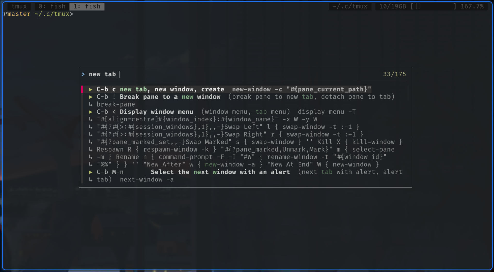

# Tmux command palette

Command palette for tmux, in the spirit of VS Code and other GUI software.

- Searchable menu to run commands
- Shows hotkeys to teach the faster way.

Trigger the palette via hotkey, type what you want — "new tab", "move pane",
hit `Enter` to execute.



## Installation

### 0. Prerequisites

- tmux 3.7+
- Systemwide python 3.11+
- [fzf](https://github.com/junegunn/fzf)
- [tpm](https://github.com/tmux-plugins/tpm)

### 1. Edit tmux config

Add the plugin to your tmux config:

```tmux
set -g @plugin 'NikolayXHD/tmux-command-palette'
```

Configure palette trigger hotkey after the tpm loader line, it should become:

```tmux
run '~/.tmux/plugins/tpm/tpm'
bind -T prefix ? tmux-command-palette
```

Alternatevely to setup VSCode-like global trigger `Ctrl + Shift + P`

```tmux
run '~/.tmux/plugins/tpm/tpm'
bind -n C-S-P tmux-command-palette
```

In that case you will need to make sure your terminal + tmux combo
is set up to properly handle `Ctrl` + `Shift` + `Key` bindings.

### 2. Trigger plugin installation

press `Prefix + I` in tmux to install the plugin.

## Command history

The palette records the commands it executes and suggests them (`↺`
rows): with an empty query the list is the last N commands, most recent
first — an empty history shows an empty list; while typing — up to N
history commands matching the query, freshest first, on top of the binding
search. A suggestion row carries its command in the hidden identity
column, so it re-runs even when no key is bound to the command any more.

`@command-palette-num-recent` — the size of the suggestion block
(default 3):

```tmux
set -g @command-palette-num-recent 3
```

The history file `tmux-command-palette.history` lives next to
`tmux-command-palette.toml`, in the fish history format: `- cmd:` / `when:`
blocks with backslash and newline escaped exactly like fish writes its own
history. One record per command: a repeat updates the record, `added_when`
keeps the first execution.

## Development

Entry point: `src/palette.py`. The personal alias file is kept up to date
automatically on every palette run; the flags run that step or the checks
standalone:

- `--gen` — update `{tmux_config_dir}/tmux-command-palette.toml`: initial
  aliases for your custom bindings
- `--check` — check `palette.toml` is complete and current for this tmux
  version (every built-in command described, no stale entries), and that
  every alias lists the glossary synonyms of its command
- `--exec table|key` — run one entry's command (for testing); `--exec
  hist|command` runs a history row's command

Initial custom aliases `{tmux_config_dir}/tmux-command-palette.toml` are
generated from `glossary.toml`:

- `[[jargon]]` maps tmux jargon words to synonym groups by words in the
  command, e.g. `kill-session` — `terminate`/`exit`/`quit` rather than
  `close`/`remove`/`delete`. The words are matched whole, in the command
  with quoted strings and `#{...}` format variables stripped out.
- `[[phrase]]` maps exact commands to human-readable forms, e.g.
  `terminate current session`

Customizing aliases: edit `tmux-command-palette.toml` next to your
`tmux.conf` (e.g. `~/.config/tmux/tmux-command-palette.toml`).

Run tests: `make test`

`src/palette_data.py` — tmux bindings layer.

`src/palette_actions.py` — execution of a selected entry.

`src/palette_ui.py` — `fzf` UI and line rendering.

`src/palette_history.py` — command history: the fish-style file.

`src/palette_suggest.sh` — the suggestion list: the recent block on top,
the entries below.

`palette.toml` — common search aliases, manually maintained in this repo.

`palette.generated.toml` — comprehensive source to build `fzf` input.

`tmux-command-palette.tmux` — tpm entry point: registers the
`tmux-command-palette` command via `command-alias[]`; the key binding is the
user's.

## AI disclosure

This plugin was vibecoded with [Pi](https://github.com/earendil-works/pi) and
deepseek-v4-flash model.
